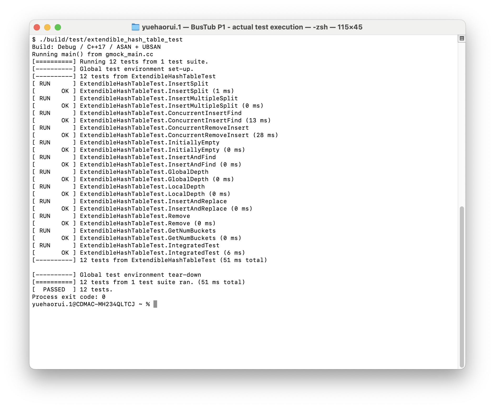
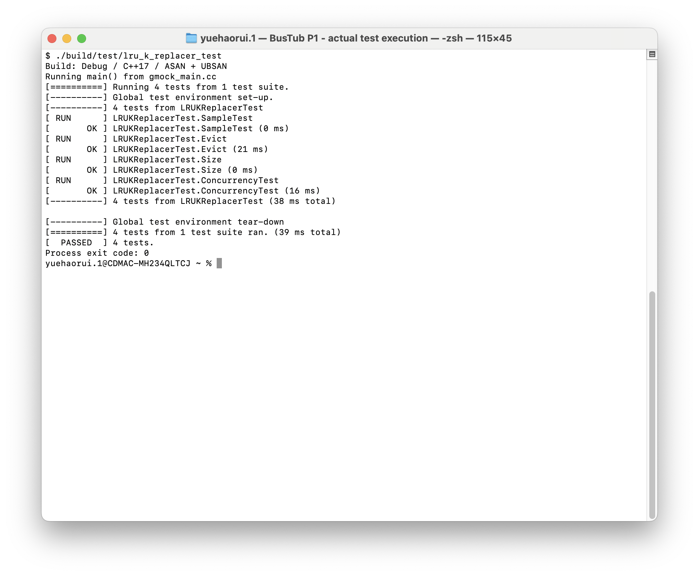
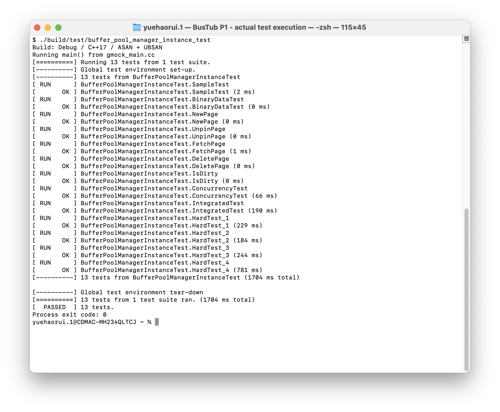
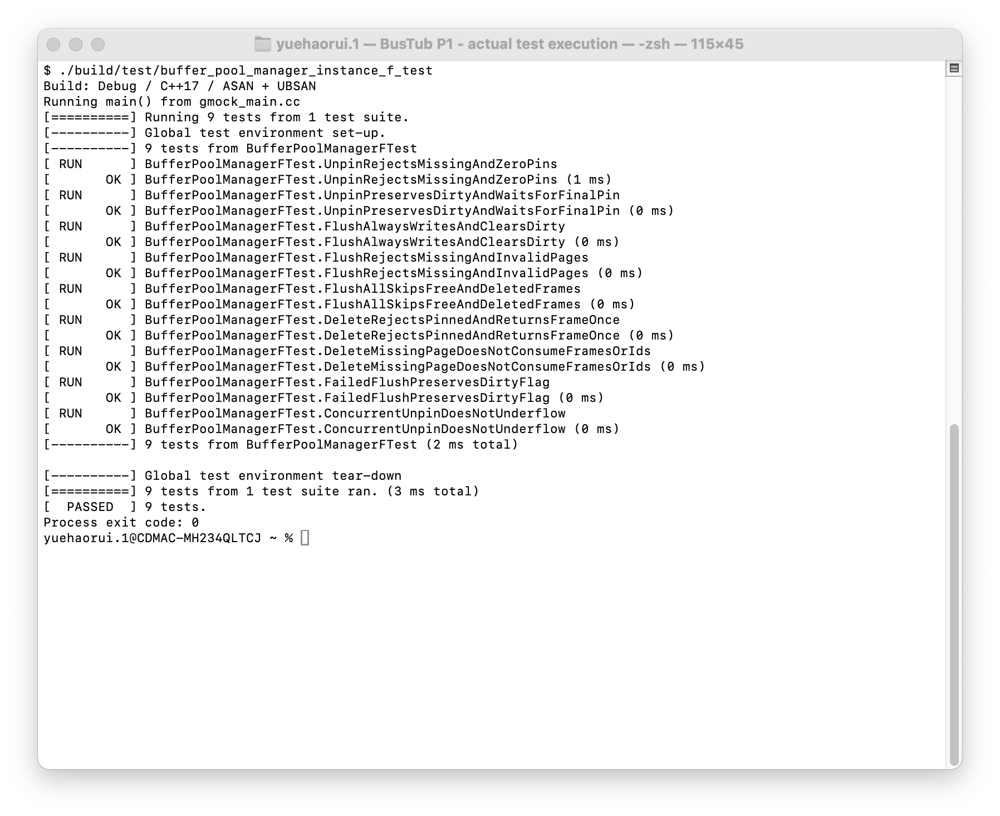

# Project 1 提交材料（Buffer Pool Manager）

## 提交信息
实验小组：13 
提交日期：2026-11-23 

## 一、实验内容

BusTub Project 1，实现缓冲池管理器，包含三个模块：

1. **Extendible Hash Table**（可扩展哈希表）——作为缓冲池的页表，维护 `page_id → frame_id` 映射；
2. **LRU-K Replacer**（LRU-K 页面替换算法）——记录帧的访问历史，决定淘汰哪一帧；
3. **Buffer Pool Manager Instance**（缓冲池管理器）——在内存与磁盘之间搬运页面，管理固定计数与脏页写回。

## 二、运行环境

- 平台：macOS Apple Silicon（arm64）
- 编译器：Apple Clang 17
- 构建：CMake 3.31.6，C++17，Debug（启用 AddressSanitizer + UndefinedBehaviorSanitizer）

## 三、测试结果

| 测试程序 | 用例数 | 结果 |
| --- | ---: | --- |
| `extendible_hash_table_test`（官方） | 12 | 全部通过 |
| `lru_k_replacer_test`（官方） | 4 | 全部通过 |
| `buffer_pool_manager_instance_test`（官方） | 13 | 全部通过 |
| `buffer_pool_manager_instance_f_test` | 9 | 全部通过 |
| `extendible_hash_table_regression_test` | 3 | 全部通过 |
| `extendible_hash_table_find_remove_test` | 11 | 全部通过 |
| `lru_k_replacer_regression_test` | 6 | 全部通过 |
| `buffer_pool_manager_regression_test` | 4 | 全部通过 |
| **合计** | **62** | **零失败、零跳过** |

其中官方测试 29 个，小组补充测试 33 个（含 F 模块的 9 个针对性用例，源码见
[test/buffer/buffer_pool_manager_instance_f_test.cpp](../../test/buffer/buffer_pool_manager_instance_f_test.cpp)）。
所有测试进程退出码均为 0，日志中无内存错误、无未定义行为报告。
`make format` 与 `make check-lint` 通过。

逐阶段的原始数据（退出码、用例数、源码 SHA-256）见
[Project 1 验收记录](../project1_验收记录_2026-11-23.md)。

## 四、运行截图

截图均为实际执行测试后的终端窗口原始截图。

### 1. 可扩展哈希表：12/12 通过



### 2. LRU-K 替换器：4/4 通过



### 3. 缓冲池管理器：13/13 通过



### 4. F 模块补充测试：9/9 通过



## 五、源码位置

六个源文件均在仓库中，与课程要求的提交清单一致：

| 文件 | 说明 |
| --- | --- |
| [extendible_hash_table.h](../../src/include/container/hash/extendible_hash_table.h) | 哈希表类声明 |
| [extendible_hash_table.cpp](../../src/container/hash/extendible_hash_table.cpp) | 哈希表实现（含桶分裂） |
| [lru_k_replacer.h](../../src/include/buffer/lru_k_replacer.h) | LRU-K 类声明 |
| [lru_k_replacer.cpp](../../src/buffer/lru_k_replacer.cpp) | LRU-K 实现 |
| [buffer_pool_manager_instance.h](../../src/include/buffer/buffer_pool_manager_instance.h) | 缓冲池类声明 |
| [buffer_pool_manager_instance.cpp](../../src/buffer/buffer_pool_manager_instance.cpp) | 缓冲池实现 |

## 六、复现方法

```bash
# 在 Linux / macOS 下
mkdir -p build && cd build
cmake -DCMAKE_BUILD_TYPE=Debug ..

make -j4 extendible_hash_table_test lru_k_replacer_test buffer_pool_manager_instance_test
./test/extendible_hash_table_test
./test/lru_k_replacer_test
./test/buffer_pool_manager_instance_test
```

## 七、实现要点

- **哈希表**：目录用 `shared_ptr` 数组，多个目录项可共享同一桶；插入前检测溢出，局部深度不够时分裂并重分配键值对；所有操作由表级互斥锁保护。
- **LRU-K**：每帧保存最多 K 个访问时间戳；淘汰时优先选择访问次数不足 K 的帧，同类中选最早访问者；`Size()` 只统计可淘汰帧。
- **缓冲池**：先取空闲帧，再向替换器申请牺牲帧；脏页复用前写回磁盘；`Unpin` 用逻辑或累积脏标记，固定计数归零后才允许淘汰；`Flush` 无论是否脏都写回。
